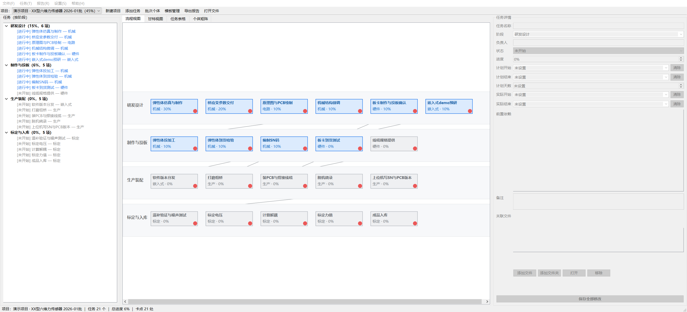
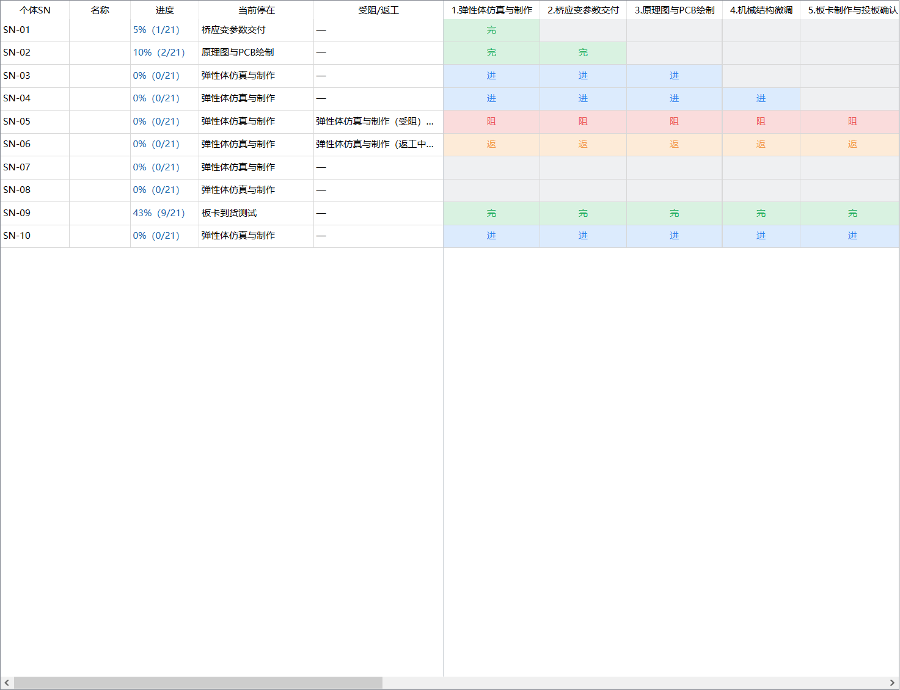
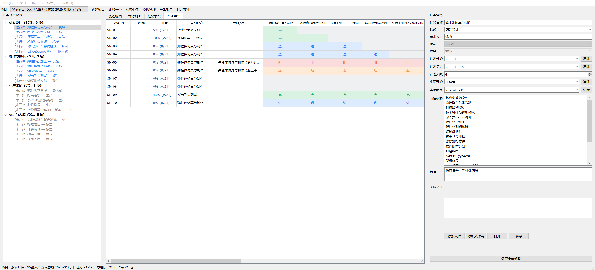

# ProjectManager

单机版产研项目进度盯控工具。最早为六维力传感器的产研全流程设计——弹性体仿真 → 应变参数 → 原理图/PCB → 投板 → 嵌入式 demo → 到货检验 → 编 SN → 打磨组桥/焊线 → 脱机烧录 → 标定温补 → 入库——但流程模板可以改成你自己的任意项目。

所有数据存在本地一个 SQLite 文件里，不联网、不依赖服务器。适合一个人或小团队自己盯进度、记卡点、出报告。

## 截图





截图来自内置演示项目。

## 功能

- **流程模板**：新建项目可一键套用内置的「六维力传感器产研流程」模板（4 阶段 21 步，含依赖与每步角色），也可以建空白项目自己搭。
- **自定义模板**：把当前项目（阶段、负责人、依赖）存成模板，下次直接选用；支持重命名、删除。
- **阶段管理**：阶段完全自定义，先建的排前面；上移/下移、重命名、删除、空白阶段都能在任务树里右键直接操作。
- **批次个体跟踪**：一批 N 个就建 N 个个体（SN-01 ~ SN-N）。个体矩阵里行=个体、列=任务，状态打点后任务进度自动算，不再手填。
- **四视图**：流程泳道图（按状态着色、依赖连线、卡点红点）、甘特图（按计划日期画条、红线标今天）、全字段表格、个体矩阵。
- **个体矩阵批量操作**：Ctrl 加选、按住拖动框选、Shift 选范围，右键整片批量改状态；最左侧若干列可冻结，往右滚也钉住不动。
- **卡点自动分析**：受阻/返工、依赖未完成、计划逾期都会自动识别并汇总。
- **报告导出**：HTML（总进度、阶段进度、批次个体进度、卡点清单、任务明细）和 Excel（概览/明细/卡点/个体进度/个体矩阵）。
- **全量数据导出/导入**：单个 JSON 带走全部数据（任务、依赖、个体、矩阵、模板），换电脑或正式版↔调试版之间迁移都用它。
- **实时保存**：详情面板里改名字/状态/进度/日期/备注/关联文件即落库，无需手动保存。
- **使用说明（F1）**：所有操作方法的分类文档，界面上不堆操作提示文字。

## 快速开始

### 方式一：下载安装包（Windows）

到 [Releases](../../releases) 页下载 `ProjectManager_Setup_<版本>.exe`，双击安装。

- 安装包只写程序目录（`C:\Program Files\ProjectManager\`），用户数据落在 `%LOCALAPPDATA%\ProjectManager\data\`。
- 覆盖升级不丢数据：双击新版安装包即可，数据库、设置、报告原样保留。
- 首次以安装版运行会把旧位置的数据自动迁过来。

### 方式二：从源码运行

需要 Windows 和 Python 3.10+（桌面应用基于 PySide6）。

```bat
git clone <repo-url>
cd ProjectManager
run.bat
```

`run.bat` 首次运行会自动建虚拟环境并装依赖（镜像回退：阿里云 → 清华 → 官方源），之后直接启动。

也可以手动：

```bat
python -m venv .venv
.venv\Scripts\activate
pip install -r requirements.txt
python run.py
```

## 从源码构建安装包

见 [docs/BUILD.md](docs/BUILD.md)——包括 PyInstaller 打包、Inno Setup 安装包、版本号规则与调试版机制。

## 目录结构

```
ProjectManager/
├── run.py / run.bat        # 入口与一键启动
├── build.bat               # 打包绿色版（PyInstaller onedir → dist/）
├── release.bat             # 生成安装包（版本号 → release/*.exe）
├── version.py              # 唯一版本号源
├── main.py                 # 应用主函数（QSS/图标/主窗口）
├── requirements.txt        # 运行依赖
├── requirements-build.txt  # 构建工具链（pyinstaller）
├── app/
│   ├── paths.py            # 程序文件 / 用户数据分离 + 旧数据迁移
│   ├── db.py               # SQLite 数据层 + 卡点分析 + 个体 + 导入导出
│   ├── templates.py        # 流程模板（可自行增改）
│   ├── ui_main.py          # 主窗口（四视图 + 详情面板 + 对话框）
│   ├── help_text.py        # 使用说明文案（F1）
│   └── report.py           # HTML / Excel 报告导出
├── installer/
│   └── ProjectManager.iss  # Inno Setup 安装脚本
├── scripts/
│   ├── build.py            # PyInstaller 构建脚本
│   ├── release.py          # 安装包生成（版本号→构建→Inno→SHA256）
│   └── make_icon.py        # 图标生成（纯 Python）
└── resources/app.ico       # 应用图标
```

> 开发模式的用户数据在项目根 `data/`；安装版在 `%LOCALAPPDATA%`。两者都不进版本库（见 `.gitignore`），你的真实项目数据不会被提交。

## 数据在哪 / 升级为什么不会丢

| | 开发模式（run.bat） | 正式版安装包 | 调试版安装包 |
|---|---|---|---|
| 程序文件 | 项目根目录 | `C:\Program Files\ProjectManager\` | `C:\Program Files\ProjectManager Debug\` |
| 用户数据 | `项目根\data\` | `%LOCALAPPDATA%\ProjectManager\data\` | `%LOCALAPPDATA%\ProjectManager Debug\data\` |
| 数据库 | `data\projects.db` | 同左 | 同左 |

安装包只写程序目录，从不包含、也不删除用户数据目录，所以双击新版安装包就是覆盖升级。菜单「文件 → 打开数据目录」可直接定位；「帮助 → 关于 / 数据位置」会显示当前实际路径。

## 快捷键

| 快捷键 | 作用 |
|---|---|
| Ctrl+N | 新建项目 |
| Ctrl+T | 添加任务 |
| Ctrl+U | 批次个体管理 |
| Ctrl+G | 阶段管理 |
| Ctrl+, | 显示设置 |
| Ctrl+R | 导出报告 |
| Ctrl+E | 导出全部数据 |
| Ctrl+PgUp / Ctrl+PgDn | 切换上/下一个项目 |
| Ctrl+滚轮 / Ctrl+0 | 视图缩放 / 缩放复位 |
| F1 | 使用说明 |

## 改模板 / 二次开发

- 流程模板改 `app/templates.py`：每个任务是 `{stage, name, owner, deps, note}`，`deps` 引用模板内的任务名。
- 状态与配色改 `app/db.py` 顶部的 `STATUS_*` 常量和 `ui_main.py` 的 `STATUS_STYLE`。
- 有批次个体的任务，其状态/进度由矩阵自动算（`db.sync_task_progress`），详情面板对应项置灰；删掉所有个体即恢复手填。
- 想接共享目录：任务「关联文件」直接填 UNC 路径（如 `\\server\share\...`）。

跑测试：`smoke_test.py`（需要 `.venv` 装好依赖），覆盖点击行为、数据不串写、冻结列、计划天数联动等回归。

## 许可证

[MIT](LICENSE)。

## 贡献

Issue 和 PR 都欢迎，见 [CONTRIBUTING.md](CONTRIBUTING.md)。
